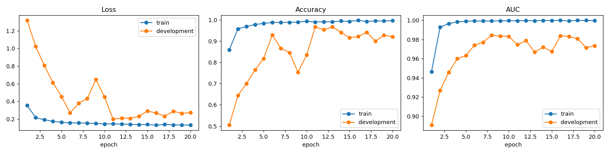
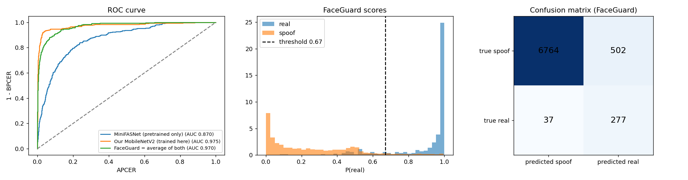

# 🔐 FaceGuard + 🤖 SiteMate

**Two-factor face access control with anti-spoofing, followed by a role-aware RAG assistant for construction project records.**

Only a **live, registered face** with the correct **designation + PIN** gets in. Printed photos, phone and laptop screens are rejected.
After login, **SiteMate** answers questions about BOQs, labour rates, work orders and safety SOPs, showing each user only what their designation is allowed to see.

---

## How it works

```
Camera ─► 1 Face detection (RetinaFace)
       ─► 2 Quality check (size, blur, light)
       ─► 3 Anti-spoofing: MiniFASNet ×2 (pretrained) + MobileNetV2 (trained on LCC-FASD), averaged
       ─► 4 Face recognition (ArcFace, cosine similarity ≥ 0.45)
       ─► 5 Designation + PIN (PBKDF2-hashed, 3 tries then 5-min lock)
       ─► ACCESS GRANTED + log ─► SiteMate RAG chatbot
```

**SiteMate (RAG):** MiniLM embeddings → Chroma vector store **filtered by role** → exact totals computed with pandas → LangChain prompt → free Groq LLM (with automatic fallback models) → streamed answer with sources.

| Designation | Can see |
|---|---|
| Technician / Electrician | Specifications, quantities, SOPs (no money) |
| Site Engineer | Specifications, sizes, makes, SOPs (no money) |
| Estimator / QS | + rates and amounts (no work orders) |
| Finance Officer | Work orders + SOPs (no BOQ rates) |
| Project Manager / Admin | Everything |

The role comes from the face + PIN login, never from the chat, and the filter runs inside the database search, so typing "I am the admin" changes nothing.

---

## Results (anti-spoofing, LCC-FASD evaluation set)

Metrics follow ISO/IEC 30107-3: **APCER** = attacks accepted, **BPCER** = real users rejected, **ACER** = their average (lower is better).
The full table is in [`results_table.csv`](results_table.csv); the threshold chosen on the development set is in [`results.json`](results.json).

| Training curves | Test results (ROC, score histogram, confusion matrix) |
|---|---|
|  |  |

---

## Features
- Live face mask camera (MediaPipe) that follows the head: green = ready, amber = adjust, red = no face
- Live progress of each security check, with the scores shown
- Onboarding questions with one-click answers, then example questions for each designation
- Exact totals over **all** matching work orders (no LLM arithmetic)
- Voice questions (Groq Whisper), 👍/👎 feedback, chat download, auto-logout after inactivity
- Admin pages: Users (add / designation / PIN / delete), Dashboard (access + chat analytics), Settings (thresholds)
- Audit trail: every access attempt and chat question is logged; photos of denied attempts are kept

---

## Run it on Google Colab
1. Open `FaceGuard_SiteMate_final.ipynb` in Colab and choose a **T4 GPU** runtime (needed only for training).
2. Add secrets in Colab (🔑 icon):
   - `GROQ_API_KEY`: free at https://console.groq.com/keys (without it the chatbot runs in search-only mode).
   - Kaggle: upload your own `kaggle.json` when asked (only for training).
3. Copy `fas_model.h5`, `results.json`, `app.py`, `face_utils.py` and `face_camera/` to `MyDrive/FaceGuard/`. Training is then skipped automatically.
4. `Runtime → Run all`, then open the link printed in Step 12.
5. First run: register the **Admin** (name, PIN, 3 live photos). Add other users from 👥 Users.

> The knowledge base (`RAG_KB_Preprocessed.zip`) is company data and is **not included** in this repository.
> To try SiteMate, put your own documents in the same format (`kb_records.jsonl` with `text` + `metadata.allowed_roles`) in `MyDrive/FaceGuard/rag/`.

## Repository contents
| File | Purpose |
|---|---|
| `FaceGuard_SiteMate_final.ipynb` | Full pipeline: setup → models → training → knowledge base → app → launch |
| `app.py` | The Streamlit app (face access + SiteMate) in one file |
| `face_utils.py` | RetinaFace, quality check, MiniFASNet, ArcFace helpers |
| `face_camera/index.html` | Browser camera with the live face mask (Streamlit component) |
| `.streamlit/config.toml` | Theme and server settings |
| `fas_model.h5` | Our trained MobileNetV2 anti-spoofing model |
| `minifas_scores.csv` | MiniFASNet scores on LCC-FASD (used for the fused evaluation) |
| `results.json`, `results_table.csv`, `*.png` | Evaluation results |
| `requirements.txt` | Python packages |

The four pretrained ONNX models (RetinaFace, MiniFASNetV2, MiniFASNetV1SE, ArcFace w600k_mbf) are downloaded automatically by the notebook and checked with SHA-256.

## References
- Deng et al., *RetinaFace: Single-stage Dense Face Localisation in the Wild*, CVPR 2020
- Deng et al., *ArcFace: Additive Angular Margin Loss for Deep Face Recognition*, CVPR 2019
- Minivision, *Silent-Face-Anti-Spoofing* (MiniFASNet)
- Sandler et al., *MobileNetV2: Inverted Residuals and Linear Bottlenecks*, CVPR 2018
- Timoshenko et al., *Large Crowdcollected Facial Anti-Spoofing Dataset* (LCC-FASD), 2019
- ISO/IEC 30107-3, *Biometric presentation attack detection: Testing and reporting*

## Author
Engr. Imran Mushtaq · Final project, AI course (2026)
